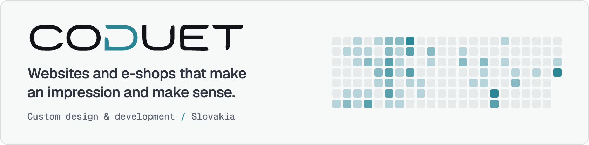
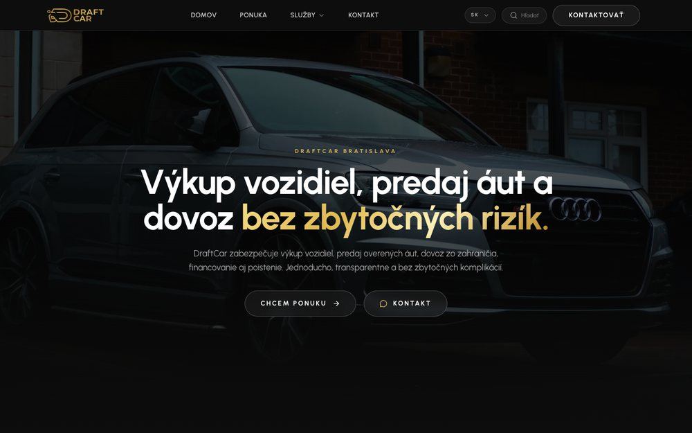
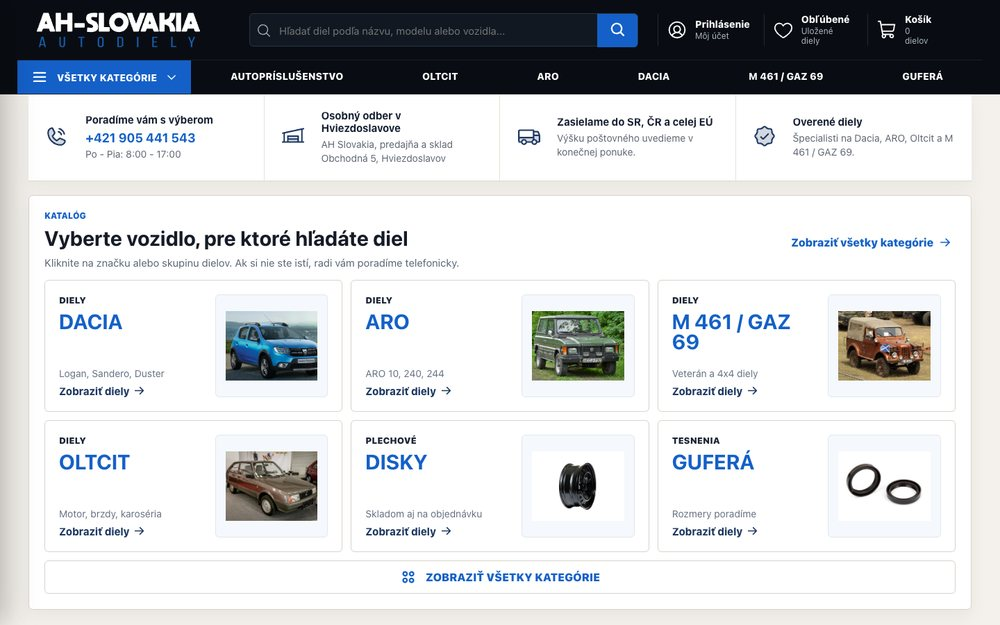
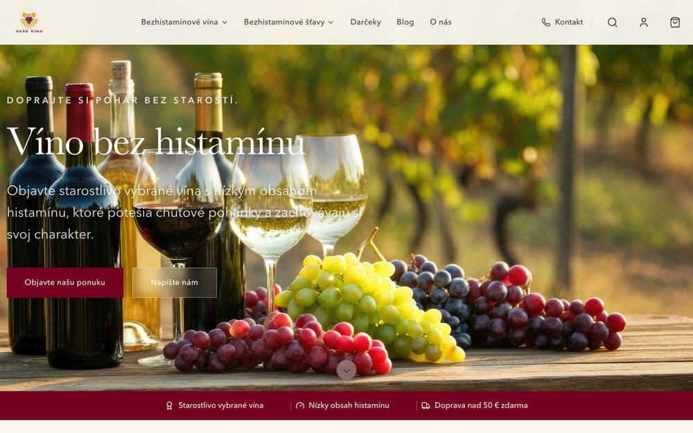
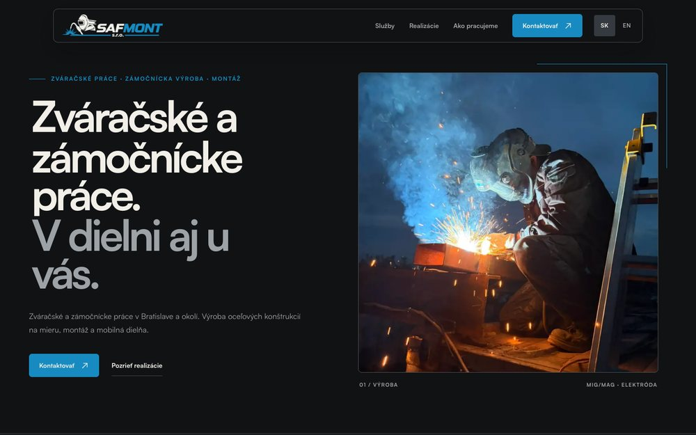

<picture>
  <source media="(prefers-color-scheme: dark)" srcset="https://raw.githubusercontent.com/zun0pipo/.github/main/profile/assets/banner-dark.png">
  <source media="(prefers-color-scheme: light)" srcset="https://raw.githubusercontent.com/zun0pipo/.github/main/profile/assets/banner-light.png">
  
</picture>

We design and build custom websites and e-shops for Slovak businesses, from the first design to deployment and upkeep.

Client code stays in private repositories, so the live sites below are the best place to see our work.

## Selected work

<table>
  <tr>
    <td width="50%" valign="top">
      
        
      <b><a href="https://draftcar.sk">DraftCar</a></b> 
      Website for a car dealership. Vehicle listings load live from Autobazar.eu through a caching mirror that also runs on static hosting.
        
      Next.js · TypeScript · Tailwind CSS · Motion · PHP
    </td>
    <td width="50%" valign="top">
      
        
      <b><a href="https://ahautodiely.sk">AH Autodiely</a></b> 
      Auto parts e-shop with a product catalogue, cart, orders, customer accounts, SEPA QR payments and an admin panel.
        
      Next.js · TypeScript · Supabase · Resend · Docker
    </td>
  </tr>
  <tr></tr>
  <tr>
    <td width="50%" valign="top">
      
        
      <b><a href="https://vasevino.sk">Vaše Víno</a></b> 
      E-shop for low-histamine wines: a custom Next.js storefront on a Medusa backend, replacing an older store.
        
      Next.js · TypeScript · Tailwind CSS · Medusa
    </td>
    <td width="50%" valign="top">
      
        
      <b><a href="https://safmont.sk">SAF Mont</a></b> 
      Slovak and English site for a welding and metalwork company, with a contact form that accepts photos and PDFs.
        
      Next.js · TypeScript · GSAP · Resend · Coolify
    </td>
  </tr>
</table>

## How we build

<table>
  <tr><td><b>Frontend</b></td><td>TypeScript, React, Next.js, Astro, Tailwind CSS, GSAP, Motion</td></tr>
  <tr><td><b>Backend and data</b></td><td>Supabase (Postgres, Auth, Edge Functions), Medusa, Resend</td></tr>
  <tr><td><b>Infrastructure</b></td><td>Docker, Coolify, Cloudflare, GitHub Actions, Sentry</td></tr>
</table>

## Get in touch

[coduet.sk](https://coduet.sk) · [info@coduet.sk](mailto:info@coduet.sk) · [LinkedIn](https://www.linkedin.com/company/coduet) · [Instagram](https://instagram.com/coduet.sk)
